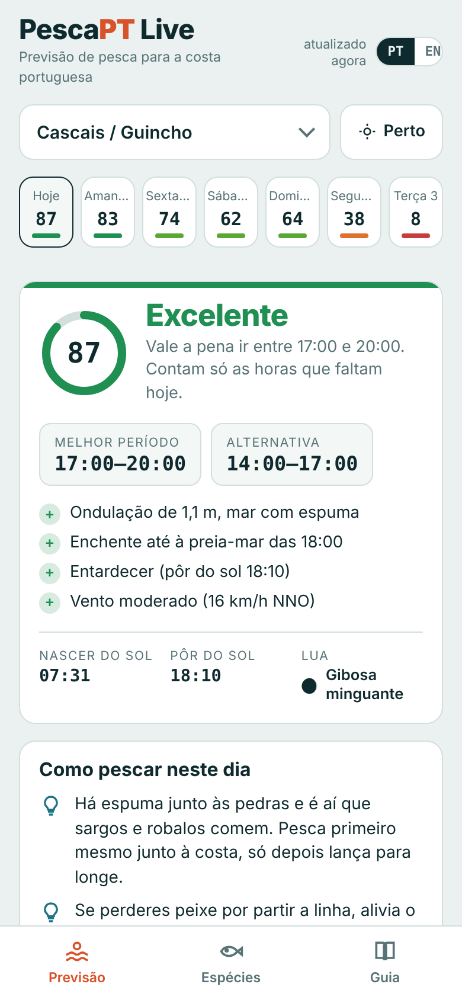

# 🎣 PescaPT Live

**PT** · Previsão de pesca para toda a costa portuguesa, Açores e Madeira incluídos: meteo, ondulação, marés, melhor hora para pescar, espécies com tamanhos mínimos legais e as regras da pesca lúdica.
**EN** · Fishing forecast for the whole Portuguese coast, including the Azores and Madeira: weather, swell, tides, best time to fish, species with legal minimum sizes and recreational fishing rules.

👉 **App:** `https://<o-teu-utilizador>.github.io/pescapt/`

---

## Português

### O que faz
- **42 zonas** de Caminha a Vila Real de Santo António, mais Madeira, Porto Santo e Açores. O botão "Perto" escolhe a zona mais próxima de ti.
- **Previsão de 7 dias** com uma pontuação de pesca de 0 a 100, hora a hora: vento, rajadas, ondulação, maré, amanhecer e entardecer, lua e pressão.
- **Melhor período do dia**, com as razões explicadas.
- **Dicas para o dia**: o que fazer com mar parado, com espuma ou com mar grande, e onde te abrigares do vento.
- **Plano B**: compara as zonas próximas para o mesmo dia.
- **Marés** (preia-mar e baixa-mar) e gráfico da maré.
- **Espécies** por zona com foto, tamanho mínimo legal (tabela DGRM 30-10-2025), isco, técnica e melhores meses.
- **Guia**: licença, limites diários, defesos, onde é proibido pescar, segurança e dicas.
- **Avisos automáticos**: época balnear, defeso do sargo na Costa Vicentina, Arrábida, Berlengas, regras do Tejo e Sado, regras regionais nas ilhas.
- Em português e em inglês. Instala-se como app no telemóvel (PWA) e funciona com rede fraca.

### Publicar no GitHub Pages
1. Cria um repositório público chamado `pescapt`.
2. Envia todos os ficheiros desta pasta para a raiz do repositório.
3. Em **Settings → Pages**, escolhe *Deploy from a branch*, branch `main`, pasta `/ (root)`.
4. Ao fim de um minuto a app fica em `https://<utilizador>.github.io/pescapt/`.

Não precisa de servidor nem de chave de API. Tudo corre no navegador.

### Avisos
- A pontuação é uma estimativa e não garante peixe. As marés vêm de um modelo e podem falhar 20 a 40 minutos junto à costa. As tabelas oficiais estão no [Instituto Hidrográfico](https://www.hidrografico.pt/).
- As regras podem mudar. Confirma sempre com a [DGRM](https://www.dgrm.pt/zonas-de-pesca) e com a capitania local. Nos Açores e na Madeira aplicam-se regras regionais.

---

## English

### Features
- **42 areas** from Caminha to Vila Real de Santo António, plus Madeira, Porto Santo and the Azores, with a "Near me" button.
- **7-day forecast** with an hourly 0–100 fishing score based on wind, gusts, swell, tide, dawn and dusk, moon and pressure.
- **Best window of the day**, with the reasons explained.
- **Daily tips** for flat, foamy or big seas, and for finding shelter from the wind.
- **Plan B**: compare nearby areas on the same day.
- **Tides** (high and low water) and a tide chart.
- **Species** per area with photos, legal minimum size (DGRM table, 30 Oct 2025), bait, technique and best months.
- **Guide**: licence, daily limits, closed seasons, where fishing is banned, safety and tips.
- Portuguese and English. Installable on your phone (PWA).

### Deploy
Push the files to a public repo and enable **GitHub Pages** (branch `main`, root folder). No server and no API keys needed.

---

## Dados e créditos · Data & credits
- Meteo e mar / Weather & marine: [Open-Meteo](https://open-meteo.com) (CC BY 4.0)
- Fotos / Photos: [Wikipedia](https://www.wikipedia.org) / Wikimedia Commons (cada foto liga à sua página / each photo links to its source)
- Regras e tamanhos mínimos / Rules & minimum sizes: [DGRM](https://www.dgrm.pt), FAQ Pesca Lúdica 2026 e Tabela de Tamanhos Mínimos de 30-10-2025

## Contribuir · Contributing
Encontraste um erro, um tamanho desatualizado ou falta uma zona? Abre uma *issue* ou um *pull request*.
Zonas e espécies estão nas constantes `ZONES` e `SPECIES` em `index.html`.

Found a mistake, an outdated size or a missing area? Open an issue or pull request. Areas and species live in the `ZONES` and `SPECIES` constants in `index.html`.

## Licença · License
MIT
